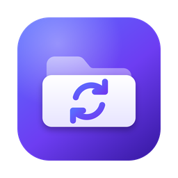
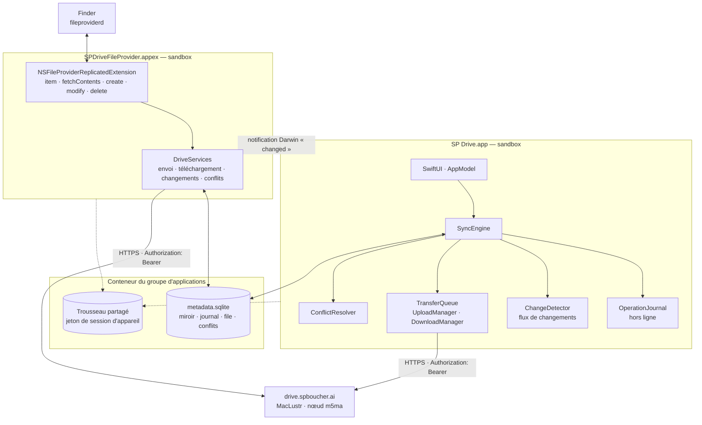
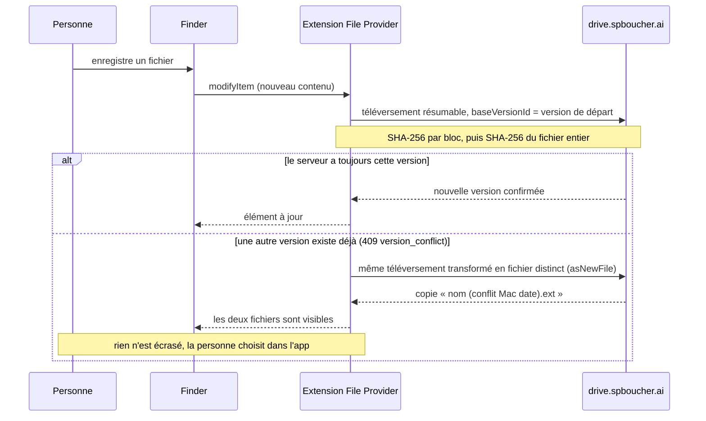
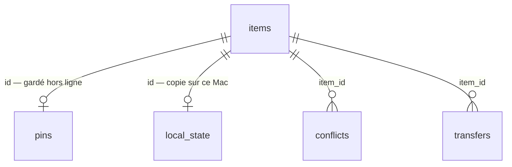

<!--
SP Drive — macOS
File: README.md
Author: Simon-Pierre Boucher
Contact: contact@spboucher.ai
-->
<div align="center">


<br><br>



# SP Drive pour macOS

**Le client macOS natif de drive.spboucher.ai, le stockage privé du cluster MacLustr : un emplacement dans le
Finder (File Provider répliqué), une application SwiftUI, un moteur de synchronisation et de transferts vérifiés
écrit en Swift. Aucun WebView, aucun moteur web, aucune dépendance tierce.**

**Auteur : [Simon-Pierre Boucher](https://www.spboucher.ai)**

[](https://drive.spboucher.ai)
%20·%20branche%20next-6a3df0?style=for-the-badge)


[](https://git.spboucher.ai/sp-drive-macos/commits)
[](https://git.spboucher.ai/sp-drive-macos/commits)
[](https://git.spboucher.ai/sp-drive-macos/insights)
[](https://git.spboucher.ai/sp-drive-macos)
[](https://git.spboucher.ai/sp-drive-macos/insights)
[](https://git.spboucher.ai/sp-drive-macos)
[](https://git.spboucher.ai/sp-drive-macos/branches)
[](https://git.spboucher.ai/sp-drive-macos/tags)
[](https://git.spboucher.ai/sp-drive-macos)


</div>

---

## Sommaire

- [Aperçu](#-aperçu)
- [Fonctions](#-fonctions)
- [Architecture](#-architecture)
- [Pile technique](#-pile-technique)
- [Organisation du dépôt](#-organisation-du-dépôt)
- [Construire et lancer](#-construire-et-lancer)
- [Configuration](#-configuration)
- [Écrans](#-écrans)
- [Modèle de données local](#-modèle-de-données-local)
- [Sécurité et confidentialité](#-sécurité-et-confidentialité)
- [Tests](#-tests)
- [Distribution](#-distribution)
- [À savoir et dépannage](#-à-savoir-et-dépannage)
- [Limites connues](#-limites-connues)
- [Documentation](#-documentation)
- [Auteur](#-auteur)
- [Licence](#-licence)

---

## 🚀 SP Drive 2.0 — état de la branche `next` (2026-11-19)

> **Non livrée.** La version distribuée et notarisée reste la 1.0.0 (`main`, étiquette `v1.0.0`). La branche `next` porte la
> 2.0.0 (3) : construite en Release, signée Developer ID et vérifiée (`Scripts/verify-release.sh` : 32 contrôles, 0 échec),
> **ni notarisée, ni installée, ni étiquetée**. Le reste de ce README décrit la 1.0 et reste vrai pour ce qu'il couvre ;
> l'état exact de la 2.0, fonction par fonction, est dans [`docs/next/AUDIT-macOS.md`](docs/next/AUDIT-macOS.md).

| | 2.0 |
|---|---|
| Serveur | SP Drive 2.0 (`sp-drive.git`, branche `next`) ; face à un serveur 1.0 l'app masque ce qu'il n'offre pas (`GET /meta`) |
| Nouveau paquet | **`SPDriveNext`** (`Next/`, Foundation seulement, macOS 14 + iOS 17) : tout ce que l'API 2.0 ajoute, partagé avec l'app iOS |
| Synchronisation | flux d'événements du serveur (SSE) branché sur le moteur, repli sur un sondage de 30 s, reprise après coupure ; concurrence adaptative 1–6, priorités, reprise après `SIGKILL`, économie d'énergie |
| Interface | système de design v2 (`docs/next/DESIGN-SYSTEM-V2.md`), grille à vraies vignettes, inspecteur, palette de commandes ⌘K, plusieurs fenêtres, Coup d'œil, glisser-déposer entrant et sortant, centre de transferts, Command Center de la barre de menus |
| Recherche | noms **et contenu** des documents (passages surlignés), recherche par le sens quand le serveur a son modèle |
| SP Drive AI | questions à un document, un dossier ou tout le Drive ; réponse en flux avec sources numérotées ; choix du modèle ; suggestions de rangement à confirmer ligne par ligne. **Aucun vrai modèle n'a été exercé** : les essais utilisent un faux fournisseur local |
| Organisation | collections intelligentes (règles), activité, versions en frise avec comparaison, centre de stockage (types, dossiers, croissance, doublons) |
| Partage | membres et rôles sur un dossier, espaces de travail, « Partagés avec moi », code QR des liens, portails de dépôt complets |
| Compte | appareils connectés (plateforme, version), consentement aux fournisseurs d'IA externes, vue d'administration pour les administrateurs |
| Finder | état « partagé », pastilles, actions du menu contextuel (déclarées et évaluées par le système ; **exécution non vérifiée**) |
| Langue | français seulement (pas de localisation anglaise, en 1.0 comme en 2.0) |

Essais du 2026-11-19 sur le code final (variante de test, backend 2.0 local @ 0073557, celui de la production) : paquets
Swift **75 / 75** (61 + 14 pour `SPDriveNext`), auto-vérification de l'app **75 / 75** deux fois de suite depuis une
liaison d'appareil neuve (dont 11 contrôles « à l'écran » qui pressent les vrais boutons par l'API d'accessibilité),
scénario Finder **22 / 22**, tournée de 34 écrans sans plantage. Captures de la
fenêtre : [`docs/next/shots/`](docs/next/shots/).

## 🎯 Aperçu

Client macOS **natif** de [drive.spboucher.ai](https://drive.spboucher.ai) (stockage privé sur le cluster MacLustr) :
Swift 6, SwiftUI/AppKit, extension File Provider pour le Finder, moteur de synchronisation et de transferts en Swift.
Aucun WebView, aucun moteur web, aucune dépendance tierce.

| | |
|---|---|
| Application | `ai.spboucher.spdrive` — macOS 14+, universelle (arm64 + x86_64), App Sandbox, runtime durci |
| Extension Finder | `ai.spboucher.spdrive.fileprovider` (File Provider répliqué) |
| Serveur | https://drive.spboucher.ai (dépôt `sp-drive.git`, nœud m5ma) — routes pour clients natifs ajoutées le 2026-11-18 |
| Paquets Swift | `SPDriveCore` (`Core/`) et `SPDriveSync` (`Sync/`), aussi liés par l'app iOS |
| Version | 1.0.0 (1), étiquette `v1.0.0`, signée Developer ID et notarisée |

État réel, fonction par fonction : [`docs/FEATURE_MATRIX.md`](docs/FEATURE_MATRIX.md). Preuves et limites :
[`docs/TEST_REPORT.md`](docs/TEST_REPORT.md). Conception : [`docs/ARCHITECTURE.md`](docs/ARCHITECTURE.md).

### Famille

| App | Plateforme | Dépôt | Rôle |
|---|---|---|---|
| **SP Drive** | Web + API — `drive.spboucher.ai` | [git.spboucher.ai/sp-drive](https://git.spboucher.ai/sp-drive) | Serveur (Fastify + PostgreSQL), site, stockage chiffré au repos, partage, portails de dépôt |
| **SP Drive pour macOS** (ce dépôt) | macOS 14+ natif | [git.spboucher.ai/sp-drive-macos](https://git.spboucher.ai/sp-drive-macos) | Application, extension Finder, paquets `SPDriveCore` et `SPDriveSync` |
| **SP Drive pour iOS / iPadOS** | iOS · iPadOS natif | [git.spboucher.ai/sp-drive-ios](https://git.spboucher.ai/sp-drive-ios) | Client natif iPhone et iPad (File Provider, hors ligne) |

---

## ✨ Fonctions

Légende de la colonne « Vérifié » (celle de [`docs/FEATURE_MATRIX.md`](docs/FEATURE_MATRIX.md)) : **T** = tests Swift
contre le vrai backend local, **A** = auto-vérification de l'app signée, **V** = écran vu dans la tournée,
**F** = scénario par le Finder. « Non vérifié » est écrit en toutes lettres.

### Repris du site

| Fonction | Client macOS | Vérifié |
|---|---|---|
| **Connexion par passkey** | Feuille système (`webcredentials`) | Serveur : T. Touch ID réel contre la production : constaté par le propriétaire |
| **Sessions, révocation d'appareil** | Paramètres › Compte | T |
| **Parcourir dossiers et fichiers** | Liste, grille, fil d'Ariane | T, A, V |
| **Créer un dossier, renommer, déplacer, dupliquer** | Oui, hors ligne aussi | T, A |
| **Favoris** | Oui | T, A |
| **Téléverser** (résumable, blocs + SHA-256) | File persistante, blocs adaptatifs | T (48 Mo, coupure, panne serveur), A |
| **Téléverser un dossier** | Glisser-déposer, sélecteur | Non vérifié de bout en bout |
| **Télécharger** (`Range`) | Reprise, vérification SHA-256, placement atomique | T, A |
| **Aperçu** | Coup d'œil natif sur copie vérifiée | Copie locale : A. Panneau Coup d'œil : non vérifié à l'écran |
| **Vignettes** | Dans le Finder (File Provider) | Non vérifié |
| **Corbeille, restauration, purge** | Purge après confirmation, en ligne seulement | T, A |
| **Versions** : liste, téléchargement, restauration, suppression | Oui | T, A, V |
| **Recherche** (nom, type, dates, tailles, favoris) | Locale, hors ligne (+ extension, dossier, partagés) | T, V |
| **Liens de partage** (mot de passe, expiration, plafonds, usage unique, révocation, journal) | Oui | T (accès public réel), A, V |
| **Liens de dépôt** (portails) | Création, pause, renouvellement, révocation, dépôts reçus | T (dépôt public réel), V |
| **Notification de dépôt** | Notification macOS | Serveur : T. Notification affichée : non vérifiée |
| **Quota** | Barre latérale, Stockage, barre de menus | A, V |
| Étiquettes, doublons, administration, récupération par code, TOTP, ajout de passkey | Non repris (restent sur le site) | — |

### Propre au client macOS

| Fonction | Détail | Vérifié |
|---|---|---|
| **Emplacement SP Drive dans le Finder** | File Provider répliqué | F : 22 / 22 sur la variante de test |
| **Liaison d'appareil par code** | Code approuvé dans un navigateur déjà connecté (`/appareil`) | T |
| **Journal d'opérations hors ligne** | Créer, renommer, déplacer, corbeille, favoris ; rejoué dans l'ordre à la reconnexion | T (serveur arrêté, « redémarrage », reprise) |
| **Ajout de fichiers hors ligne** | Copie mise en attente dans le conteneur | T |
| **Synchronisation incrémentale** | Flux de changements du serveur | T |
| **Conflits** | Détection, copie de conflit, résolution (garder les deux, la sienne, celle du serveur) | T, F ; écran de résolution : V |
| **Disponibilité hors ligne** | Épingler un fichier ou un dossier | Fichier : A. Dossier entier : non vérifié |
| **Libérer l'espace local, vider le cache** | Éviction d'un fichier désépinglé puis relecture intacte | Vérifié ; cache : A |
| **File de transferts** | Pause, reprise, annulation, réessai, priorités, parallélisme adaptatif, limites de débit | T |
| **Barre de menus** | Oui | Non vérifiée à l'écran |
| **Notifications** | Lot terminé, conflit, erreur persistante, espace, dépôt | Non vérifiées à l'écran |
| **Verrou Touch ID** | Oui | Non vérifié |
| **Ouverture à l'ouverture de session** | `SMAppService` | Non vérifié |
| **Tableau de bord du stockage** | Oui | V |

### Absent du serveur, donc absent du client

| Fonction | Raison |
|---|---|
| « Partagés avec moi », partage privé entre comptes, permission de modification | Le serveur n'a pas de partage entre comptes : rien n'est affiché plutôt qu'un écran vide |
| Recherche dans le contenu des documents | Pas d'index de contenu côté serveur |
| Auteur d'une version | Compte unique par arbre : non exposé |
| Chiffrement de bout en bout | Non construit ; l'app le dit dans ses réglages |

---

## 🏗 Architecture



### Modifier un fichier depuis le Finder, conflit compris



### Deux chemins d'écriture, un seul contrat

- **Dans le Finder** : le système tient la réplique locale et son propre journal ; il appelle l'extension pour pousser
  ce qui a été créé, modifié, renommé, déplacé, mis à la corbeille. Hors ligne, l'extension répond
  `serverUnreachable` et le système réessaie ; l'app signale la fin de la panne.
- **Dans l'application** : chaque action est écrite dans `ops` (journal SQLite) et appliquée au miroir au même
  instant, puis rejouée dans l'ordre contre le serveur. Les dossiers créés hors ligne portent un identifiant
  `local-…` échangé contre l'identifiant du serveur à la création. Les envois passent par `transfers` (copie mise
  en attente dans le conteneur).

Dans les deux cas : un contenu envoyé comme nouvelle version nomme la version dont il dérive. Si le serveur en a une
autre, rien n'est écrasé : les octets deviennent une **copie de conflit** (`nom (conflit <Mac> <date>).ext`), le
conflit est enregistré, et la personne choisit (garder les deux, la sienne, celle du serveur) — la version écartée
va à la corbeille.

### Intégrité

- **Envoi** : SHA-256 par bloc et du fichier entier, confirmé par le serveur avant tout « terminé » ; un fichier
  modifié pendant l'envoi est refusé.
- **Téléchargement** : écriture dans un fichier partiel étiqueté par le SHA-256 attendu, reprise par `Range` +
  `If-Range`, hachage en flux, puis `F_FULLFSYNC` et `rename` atomique seulement si taille et empreinte concordent ;
  un partiel d'une autre version ou abîmé n'est jamais livré.

### Ce que le serveur a reçu pour les clients natifs (migration `002_native_clients`, additif)

Session d'appareil (jeton porté en `Authorization: Bearer`, durée glissante, fermé après 90 jours de silence, listé
et révocable) · liaison par code (`auth/device/start|poll|info|decide` + page `/appareil`, approbation par passkey
fraîche) · flux de changements (`GET /sync/changes`, `/sync/cursor`, `POST /sync/items`, pierres tombales pour les
purges) · conflits (`baseVersionId` → 409 `version_conflict`, `PATCH /uploads/:id/options {asNewFile}`) · fichier
d'association Apple (`/.well-known/apple-app-site-association`).

---

## 🧱 Pile technique

| Couche | Technologie | Version / réglage | Rôle |
|---|---|---|---|
| Langage | Swift | 6.0, `SWIFT_STRICT_CONCURRENCY: complete` | Tout |
| Interface | SwiftUI + AppKit | `@Observable` | Fenêtre principale, barre de menus, réglages |
| Finder | FileProvider | `NSFileProviderReplicatedExtension` | Emplacement SP Drive dans le Finder |
| Persistance | SQLite (`sqlite3` du système) | schéma du miroir version 1 | Miroir, journal, file de transferts, conflits |
| Authentification | AuthenticationServices | `webcredentials:drive.spboucher.ai` | Passkeys système |
| Secrets | Trousseau à protection des données | groupe partagé app + extension | Jeton de session d'appareil |
| Ouverture de session | ServiceManagement (`SMAppService`) | — | Lancement à l'ouverture de session |
| Paquets | SwiftPM : `SPDriveCore`, `SPDriveSync`, `spdrive-cli` | swift-tools 6.0 ; macOS 14, iOS 17 | Salle des machines sans interface, liée aussi par l'app iOS |
| Projet | XcodeGen (`project.yml`) | — | Génère `SPDrive.xcodeproj` |
| Système minimal | macOS | 14.0 | — |
| Dépendances tierces | aucune | 0 | Vérifié sur le produit signé par `Scripts/verify-release.sh` |

---

## 🗂 Organisation du dépôt

```
sp-drive-macos/
├── Package.swift               # SPDriveCore (Core/), SPDriveSync (Sync/), spdrive-cli, tests
├── project.yml                 # XcodeGen : app SPDrive + extension SPDriveFileProvider
├── App/                        # 10 fichiers · 992 lignes — entrée, modèle (AppModel), environnement partagé
│   │                           #   app/extension, passkey, réglages, notifications, navigation
│   └── DevSelfTest.swift, DevTour.swift     # variante de test seulement
├── Core/                       # 12 fichiers · 1 408 lignes — SPDriveCore
│   ├── API/                    #   APIClient, Endpoints, DriveError
│   ├── Authentication/         #   AuthAPI
│   ├── Persistence/            #   MetadataStore, SQLite
│   ├── Security/               #   Hashing, KeychainTokenStore, NameRules
│   ├── Networking/             #   NetworkMonitor
│   ├── Metadata/               #   LocalSearch
│   └── Models/
├── Sync/                       # 8 fichiers · 1 155 lignes — SPDriveSync : SyncEngine, ChangeDetector,
│                               #   ConflictResolver, TransferQueue, UploadManager, DownloadManager,
│                               #   IntegrityVerifier, OperationJournal
├── FileProviderExtension/      # 5 fichiers · 558 lignes — extension Finder (FileProviderExtension, Enumerator,
│                               #   Item, DriveServices) + gestion du domaine côté app (FileProviderManager)
├── Features/                   # 12 fichiers · 1 687 lignes — écrans SwiftUI
│   ├── Home/                   #   MainView, MenuBarView, RootView
│   ├── MyDrive/                #   BrowserView, ItemActions, Sheets
│   ├── Shared/                 #   ShareSheet, PortalViews
│   ├── Transfers/, Offline/ (StorageView), Settings/, Account/ (LoginView)
├── Components/                 # vues et formats partagés
├── Resources/                  # Info.plist, droits, catalogue d'images (Release et variante Dev)
├── Tests/CoreTests/            # tests unitaires et d'intégration (vrai backend local)
├── Tools/spdrive-cli/          # petit client en ligne de commande : joue « un autre appareil » dans les scripts
├── Scripts/                    # construction, backend de test, tests, scénario Finder, distribution
└── docs/                       # ARCHITECTURE, FEATURE_MATRIX, TEST_REPORT, brand/
```

---

## 🛠 Construire et lancer

```bash
Scripts/backend-dev.sh start        # vrai backend SP Drive local (clone ~/dev/sp-drive-testbed, base sp_drive_macdev, port 8665)
Scripts/t.sh [filtre] [secondes]    # swift test : 15 tests unitaires + 27 d'intégration contre ce backend
python3 Scripts/provision.py        # identifiants + profils Developer ID (clé App Store Connect existante), idempotent
Scripts/build.sh [Debug|Release]    # Debug = variante « SP Drive Dev » (identifiants .dev, backend local)
Scripts/run-dev.sh --link --keep    # lance la variante de test et la connecte par code d'appareil
Scripts/run-dev.sh --keep -- -spdSelfTest YES   # 19 vérifications faites par l'app signée elle-même
Scripts/run-dev.sh --keep -- -spdTour YES       # parcourt les 22 écrans et enregistre une image de chacun
Scripts/finder-scenario.sh          # scénario de validation par le Finder (exige l'emplacement activé dans Réglages Système)
Scripts/release.sh && Scripts/verify-release.sh && Scripts/notarize.sh   # archive, 32 contrôles, notarisation + DMG
```

Les produits de construction vont dans `~/Library/Developer/SPDrive/` (hors de `~/Desktop`, que les services système
qui chargent l'extension ne peuvent pas lire).

| Script | Rôle |
|---|---|
| `Scripts/backend-dev.sh start\|stop\|env\|web-stop\|web-start` | Un vrai backend SP Drive sur ce Mac pour les tests : le code du cluster, sa propre base PostgreSQL, son propre dossier de données et sa clé maîtresse. `web-stop` / `web-start` arrêtent et relancent le serveur sur les mêmes données (tests « hors ligne »). Rien ne touche la production |
| `Scripts/backend-helper.mts` | Authentificateur WebAuthn logiciel réservé aux tests : crée le compte de test, ouvre des sessions d'appareil, approuve les codes de liaison par la vraie API |
| `Scripts/t.sh [filtre] [secondes]` | `swift test` avec filtre et limite de temps, n'affiche que les verdicts |
| `Scripts/build.sh [Debug\|Release]` | Génère le projet Xcode et construit l'app avec son extension |
| `Scripts/run-dev.sh [--shot f.png] [--wait s] [--keep] [--link] [-- arguments]` | Lance « SP Drive Dev » contre le backend de test ; peut capturer sa propre fenêtre (jamais l'écran) |
| `Scripts/seed-demo.sh` | Remplit le compte de test d'une petite bibliothèque de démonstration (contenu synthétique) |
| `Scripts/finder-scenario.sh` | Scénario de validation par le vrai emplacement Finder de la variante de test |
| `Scripts/provision.py`, `Scripts/asc.py` | Identifiants et 4 profils Developer ID (app, extension et leurs variantes `.dev`) par l'API App Store Connect |
| `Scripts/release.sh` · `verify-release.sh` · `notarize.sh` | Archive Release universelle, 32 contrôles, notarisation et DMG |
| `Scripts/make-icon.sh` · `window-shot.swift` | Rendu de l'icône · capture d'une fenêtre |

`spdrive-cli` (même moteur que l'app) : `ls`, `changes`, `mkdir`, `put`, `putversion`, `get`, `cat`, `rename`,
`trash`, `restore`, `find`, `link`, avec `SPDRIVE_URL` et `SPDRIVE_TOKEN` dans l'environnement.

---

## ⚙️ Configuration

| Réglage | Où | Sens |
|---|---|---|
| Identifiants | `project.yml` | Release : `ai.spboucher.spdrive` (« SP Drive ») + `.fileprovider` · Debug : `ai.spboucher.spdrive.dev` (« SP Drive Dev ») + `.dev.fileprovider` |
| `SPD_DEV` | condition de compilation, Debug seulement | Variante de test : ses propres identifiants, conteneur, élément de trousseau et emplacement Finder ; autorisée à parler à un backend local. Signée comme la version distribuée (Developer ID + profils) |
| `SPDRIVE_URL`, `SPDRIVE_TOKEN` | environnement | Serveur et jeton pour `spdrive-cli` |
| `NOTARY_PROFILE` | environnement | Profil `notarytool` existant utilisé par `Scripts/notarize.sh` |
| Arguments de la variante de test | `Scripts/run-dev.sh -- …` | `-spdSection <section>`, `-spdGrid YES`, `-spdFolder <nom>`, `-spdSearch <texte>`, `-spdSelect <nom>`, `-spdInspector YES`, `-spdSheet share\|versions\|portal\|rename\|move\|newFolder`, `-spdSelfTest YES`, `-spdTour YES` |
| Droits (Release) | `Resources/SPDrive.entitlements` | App Sandbox, réseau sortant, groupe d'applications, fichiers choisis par la personne, dossier Téléchargements, domaine associé `webcredentials:drive.spboucher.ai`, groupe de trousseau partagé |

---

## 🖥 Écrans

11 sections de barre latérale (`App/Navigator.swift`) :

| Section | Titre | Contenu |
|---|---|---|
| `drive` | Mon Drive | Navigateur de l'arbre (liste, grille, fil d'Ariane, inspecteur) |
| `recent` | Récents | Navigateur |
| `shared` | Partagés par moi | Liens de partage |
| `portals` | Liens de dépôt | Portails et dépôts reçus |
| `favorites` | Favoris | Navigateur |
| `offline` | Disponibles hors ligne | Éléments épinglés |
| `downloads` | Téléchargements | Téléchargements |
| `transfers` | Transferts | File d'envois et de téléchargements |
| `conflicts` | Conflits | Conflits et leur résolution |
| `trash` | Corbeille | Navigateur |
| `storage` | Stockage | Tableau de bord du stockage et du quota |

Six feuilles : nouveau dossier, renommer, déplacer, partager, lien de dépôt, versions. S'y ajoutent l'écran de
connexion, les réglages et la barre de menus. La tournée `-spdTour` affiche 22 écrans et feuilles.

---

## 🗄 Modèle de données local

Miroir `metadata.sqlite` (version 1), un par serveur et par compte, dans le conteneur du groupe partagé par l'app et
l'extension.

| Table | Rôle |
|---|---|
| `items` | Un fichier ou dossier tel que décrit par le serveur (`rev`), + `name_key` (recherche sans accents), `seq` (compteur local de changements) |
| `tombstones` | Identifiants supprimés définitivement (`seq`) |
| `pins` | Éléments gardés hors ligne (un dossier couvre ses descendants) |
| `local_state` | Copies présentes sur ce Mac, rapportées par le File Provider |
| `ops` | Journal des opérations décidées ici (`pending` / `done` / `failed`) |
| `transfers` | File persistante des envois et téléchargements |
| `upload_sessions` | Sessions de téléversement reprenables (destination + SHA-256 + taille → identifiant serveur) |
| `conflicts` | Conflits et leur résolution |
| `meta` | Curseur du flux, racine, génération du miroir, `seq` |



Les liens se font par identifiant d'élément ; le schéma ne déclare pas de clé étrangère. `ops`, `upload_sessions`,
`tombstones` et `meta` sont autonomes.

L'ancre de synchronisation donnée au File Provider est `génération:seq` : elle expire si le miroir est reconstruit.

---

## 🔐 Sécurité et confidentialité

- **Connexion** : passkey (Touch ID) via `webcredentials:drive.spboucher.ai`, ou liaison par code approuvé dans un
  navigateur déjà connecté (`/appareil`). Le jeton de session d'appareil est dans le trousseau, groupe partagé avec
  l'extension (`AfterFirstUnlockThisDeviceOnly`), jamais dans un fichier ni un journal.
- **Transport** : HTTPS obligatoire (HTTP refusé hors boucle locale ; la version distribuée n'a aucune exception
  ATS) ; validation TLS du système.
- **Chiffrement** : TLS en transit, chiffrement au repos côté serveur. Ce n'est **pas** du chiffrement de bout en
  bout : le serveur détient les clés.
- **Isolation** : App Sandbox + runtime durci pour l'app et l'extension.
- **Chemins** : noms assainis comme le serveur et chemins contrôlés avant toute écriture (refus de traversée de
  chemin et de lien symbolique sortant) ; aucune adresse interne de stockage dans un lien.
- **Suppression** : une suppression faite dans l'app ou dans le Finder met à la corbeille de SP Drive. Seule une
  action explicite sur un élément déjà dans la corbeille supprime définitivement.
- **Consentement Finder** : l'application ne contourne pas l'activation de l'emplacement par la personne.

---

## 🧪 Tests

Aucun résultat n'est simulé : chaque test lit le serveur ou le disque.

| Suite | Résultat | Commande |
|---|---|---|
| Paquets Swift — 15 unitaires + 27 d'intégration contre le backend réel local (1.0) | **42 / 42** | `Scripts/t.sh` |
| Paquets Swift de la branche `next` (2.0) — `CoreTests` 61 + `NextTests` 14, backend 2.0 local | **75 / 75** | `Scripts/t.sh` |
| Auto-vérification de l'app signée Developer ID, sandboxée | **19 / 19** | `Scripts/run-dev.sh --keep -- -spdSelfTest YES` |
| Tournée des écrans | 22 écrans et feuilles sans plantage | `Scripts/run-dev.sh --keep -- -spdTour YES` |
| Scénario par le Finder (variante de test) | **22 / 22** | `Scripts/finder-scenario.sh` |
| Contrôles du produit distribué | **32 contrôles, 0 échec** | `Scripts/verify-release.sh` |

<details>
<summary><b>Détail des 42 tests Swift</b></summary>

- **Unitaires (15)** : règles de nommage identiques au serveur ; refus de traversée de chemin et de lien symbolique
  sortant ; miroir (révisions qui n'avancent que vers l'avant, ancres paginées avec pierres tombales, épingles
  héritées et persistantes, recherche et filtres, 60 000 éléments en moins de 2 s, reconstruction) ; classement des
  changements ; conseiller de parallélisme ; limiteur de débit ; refus du HTTP en clair.
- **Sessions (2)** : jeton porteur, jeton refusé ; liaison par code approuvée, remise une seule fois,
  déconnexion = révocation.
- **Arbre (1)** : cycle complet dossier / fichier, purge seulement depuis la corbeille.
- **Transferts (8)** : 48 Mo aller-retour en flux et vérifié ; fichier vide ; envoi coupé puis repris à l'offset du
  serveur ; envoi qui traverse un arrêt du serveur ; échec propre si le serveur reste arrêté ; téléchargement coupé
  puis repris par `Range` ; partiel abîmé jamais livré ; reprise après changement de contenu qui repart de zéro.
- **Conflits (2)** : édition périmée → copie de conflit, original intact, contenu local préservé ; résolutions
  « la mienne » et « celle du serveur ».
- **Partage (3)** : lien protégé vu par un visiteur anonyme réel ; lien de dossier confiné ; portail de dépôt.
- **Versions (1)**, **flux de changements (3)**, **journal hors ligne (2)**, **file de transferts (3)**,
  **boucle de synchronisation (2)**.

</details>

<details>
<summary><b>Les six étapes du scénario Finder</b></summary>

| Étape | Vérifié |
|---|---|
| 1. Parcourir, télécharger | Dossier créé par un autre appareil visible ; petit fichier lu = contenu du serveur ; fichier de 20 Mo lu avec le SHA-256 du serveur |
| 2. Modifier | Fichier modifié dans le Finder → version 2 sur le serveur, contenu identique |
| 3. Créer, renommer, déplacer | Confirmés par le serveur |
| 4. Conflit | Copie « (conflit …) » sur le serveur, version de l'autre appareil non écrasée, version de ce Mac préservée, le Finder montre les deux |
| 5. Hors ligne | Serveur arrêté : modifications, ajout, création ; application et extension tuées puis relancées ; serveur relancé → tout arrive intact (SHA-256) |
| 6. Supprimer | Suppression dans le Finder → corbeille du serveur ; restauration sur le serveur → retour dans le Finder |

</details>

Épinglage hors ligne (essai dédié) : fichier épinglé → téléchargé, SHA-256 identique ; éviction refusée par le système
tant qu'il est épinglé ; désépinglé → évincé ; relu → contenu identique.

---

## 📦 Distribution

```bash
python3 Scripts/provision.py     # identifiants + 4 profils Developer ID, idempotent
Scripts/release.sh               # archive Release universelle signée Developer ID
Scripts/verify-release.sh        # 32 contrôles sur l'app et l'extension
Scripts/notarize.sh              # notarisation, agrafage, DMG
```

| Élément | Valeur |
|---|---|
| Version | 1.0.0 (1) — étiquette `v1.0.0` |
| Signature | Developer ID Application, manuelle, `--timestamp`, runtime durci ; profils « SP Drive Developer ID » et « SP Drive File Provider Developer ID » |
| Contrôles | App et extension : signature, runtime durci, horodatage, sandbox, groupe, trousseau, profils ; domaine associé ; point d'extension ; aucun moteur web ; aucun reliquat de développement ; aucune exception ATS |
| Notarisation | App et DMG **Accepted**, tickets agrafés |
| Gatekeeper | `spctl` : app et DMG « accepted — Notarized Developer ID » |
| Produit | `dist/SPDrive-1.0.0.dmg` et son SHA-256 dans `dist/SPDrive-1.0.0.dmg.sha256` (hors git) |

---

## 🩺 À savoir et dépannage

| Sujet | Explication |
|---|---|
| **Activation dans le Finder** | macOS garde un nouvel emplacement File Provider désactivé jusqu'à ce que la personne l'active dans Réglages Système › Général › Ouverture et extensions › Fournisseurs de fichiers. L'application le détecte, l'explique et ouvre le bon panneau ; elle ne contourne pas ce consentement |
| **Erreur passkey 1004** | Cause établie : le robot d'Apple avait demandé le fichier d'association avant la mise en production de la route ; le site avait répondu sa page HTML et le CDN d'Apple a gardé « Bad JSON content » une heure. Diagnostic : `nscurl -i https://app-site-association.cdn-apple.com/a/v1/drive.spboucher.ai` (pas `curl`, dont l'en-tête `Accept-Encoding` désigne une autre entrée du cache). Remède : attendre l'expiration du cache |
| **Épinglage différé** | `requestDownloadForItem` est accepté mais différé par macOS sur batterie ; l'app lit donc elle-même les fichiers épinglés (lecture coordonnée) pour un téléchargement immédiat |
| **Plantage sur macOS 27** | Cellules de tableau, menus et barre d'outils lisaient le modèle dans l'environnement SwiftUI, absent à ces endroits : le modèle leur est passé explicitement |
| **« The timestamp service is not available »** | Panne passagère du service d'horodatage d'Apple pendant `Scripts/release.sh` : relancer |
| **Construire hors de `~/Desktop`** | Les services système qui chargent l'extension ne peuvent pas y lire : produits dans `~/Library/Developer/SPDrive/` |
| **Tests d'intégration** | Ils exigent `Scripts/backend-dev.sh start` ; le scénario Finder exige en plus l'app de test connectée (`Scripts/run-dev.sh --link --keep`) et l'emplacement « SP Drive Dev » activé |
| **Purge** | Possible en ligne seulement, après confirmation, et seulement depuis la corbeille |

---

## 🧭 Limites connues

Non vérifié ([`docs/TEST_REPORT.md`](docs/TEST_REPORT.md)) :

1. **Le Finder sur la version distribuée** : le scénario a été exécuté sur la variante de test (même code, autres
   identifiants). L'emplacement « SP Drive » de production n'existe qu'après connexion du propriétaire, qui doit
   aussi l'activer dans Réglages Système. Vignettes dans le Finder, ouverture et enregistrement depuis une
   application graphique : non observés.
2. **Version distribuée contre la production** : elle n'a pas été lancée connectée par un test (aucun compte de
   test en production). La connexion par passkey réelle (Touch ID) fonctionne, constatée par le propriétaire.
3. Redémarrage réel du Mac ; reprise après veille.
4. Notifications, barre de menus, verrou Touch ID, ouverture de session, Coup d'œil : non observés à l'écran.
5. VoiceOver ; autre Mac, Intel, macOS 14–26.
6. Aucun test d'interface XCUITest (la tournée et l'auto-vérification en tiennent lieu).
7. Débit sur liaison lente ou coûteuse : le conseiller de parallélisme n'est testé que par ses règles.

Non repris du site : étiquettes, doublons, administration (invitations, quotas), récupération par code, TOTP, ajout
de passkey. Pas de chiffrement de bout en bout.

---

## 📚 Documentation

| Document | Contenu |
|---|---|
| [`docs/ARCHITECTURE.md`](docs/ARCHITECTURE.md) | Audit du système existant, ajouts au backend, client macOS, intégrité, schéma du miroir, sécurité |
| [`docs/FEATURE_MATRIX.md`](docs/FEATURE_MATRIX.md) | Matrice de parité site ↔ client macOS, avec la manière dont chaque fonction a été vérifiée |
| [`docs/TEST_REPORT.md`](docs/TEST_REPORT.md) | Rapport de tests : backend, paquets Swift, application signée, Finder, distribution, non vérifié |

---

## 👤 Auteur

<div align="center">
<br>

**Simon-Pierre Boucher** — conception, développement, exploitation<br>
[www.spboucher.ai](https://www.spboucher.ai) · [git.spboucher.ai](https://git.spboucher.ai) · contact@spboucher.ai

</div>

---

## 📄 Licence

Tous droits réservés © 2026 Simon-Pierre Boucher.
